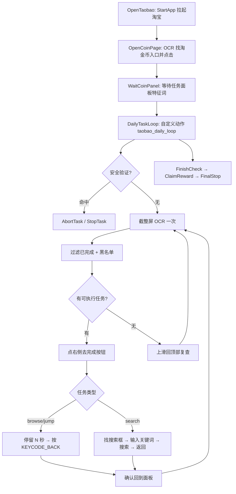

# AutoTaskFlow

基于 **MaaFramework** 的 Android 界面自动化项目，场景为**淘宝「淘金币」日常任务自动化**。

> **免责声明**：本项目仅用于技术学习与个人设备上的自动化研究。使用者需自行确保其行为符合目标应用的服务条款及当地法律法规。因使用本项目造成的任何后果（包括但不限于账号受限、封禁等）与开发者无关。

---

## 这是什么

一个真实可运行的 MaaFramework 工程，不是模板壳子。核心设计决策：

| 决策 | 原因 |
| --- | --- |
| 纯截图 OCR，不用 AccessibilityNode | 淘宝 UC WebView 的节点会失效，纯 OCR 更稳 |
| **主循环写在 Agent（Python）里，不用 `next` 链** | Pipeline 的 `next` 是「逐个节点试匹配」，黑名单节点会反复命中，永远推进不下去。要表达「从 N 个候选里挑一个」必须用代码 |
| 点击打在右侧「去完成」按钮上 | 任务名与按钮是两个独立 OCR 文字块，点任务名通常没反应 |
| 安全验证命中即 `StopTask` | 滑块/验证码不能自动化，越界操作风险极高 |

架构分工：

```text
interface.json (PI v2)            →  拉起 Agent、声明资源包与控制器
assets/resource/pipeline/*.json   →  只负责导航、收尾、OCR 节点定义
agent/actions.py                  →  真正的任务循环（截图 → OCR → 过滤 → 挑一个 → 点 → 返回）
agent/panel.py                    →  纯逻辑（解析/排序/挑选），无 maa 依赖，可离线测试
```

---

## 目录结构

```text
.
├── interface.json                  # ProjectInterface v2 配置
├── assets/resource/pipeline/
│   ├── entry.json                  # 启动淘宝 → 进入淘金币 → 等面板
│   ├── scan.json                   # OCR 节点定义 + 主循环挂载点
│   ├── action.json                 # 安全验证检测节点
│   └── finish.json                 # 收尾领奖 + 终止节点
├── agent/
│   ├── main.py                     # AgentServer 入口（由 interface.json 拉起）
│   ├── actions.py                  # 自定义动作 taobao_daily_loop
│   ├── panel.py                    # OCR 解析与任务挑选（纯逻辑）
│   ├── custom.py                   # 名单加载与任务分类
│   └── runner.py                   # 无设备的本地模拟调度器
├── config/tasks.json               # 黑名单 / 任务名单 / 时序参数 / 目标应用与用户
├── tools/validate_project.py       # 离线校验（PI v2 + 协议 + 引用闭合）
└── tests/                          # 69 项单元测试
```

---

## 快速开始

```powershell
# 1. 离线校验：不接设备，检查全部配置是否合法
python .\tools\validate_project.py

# 2. 单元测试
python -m unittest discover -s .\tests -v

# 3. 无设备本地模拟（打印决策过程，含安全停止演示）
python -m agent.runner --no-sleep
```

需要真机时：

```powershell
# 1. 装 MaaFramework 运行时（自带全部 DLL，不需要另下 release 压缩包）
python -m pip install MaaFw

# 2. 只截一张图看 OCR 识别到什么（首次上机必做）
python -m tools.device_runner --probe

# 3. 真跑一遍
python -m tools.device_runner
```

跑应用分身时（淘宝装在 Android 独立用户下）：

```powershell
python -m tools.device_runner --users          # 先列出设备上的用户，确认分身 ID
python -m tools.device_runner --user 999       # 再指定用户运行
```

详见下方「真机运行」。

---

## 真机运行

### 前置条件

| 项 | 要求 | 自检命令 |
| --- | --- | --- |
| Python | ≥ 3.9（本项目实测 3.14） | `python -V` |
| MaaFramework | `pip install MaaFw`（内含 Framework/Toolkit/AgentServer 动态库） | `python -c "import maa; from maa.library import Library; print(Library.version())"` |
| ADB | 能被 MaaToolkit 找到（`adb` 在 PATH，或用 `--adb` 指定） | `adb devices` |
| 手机 | 已开 USB 调试并授权本机 | 见上 |
| 淘宝 | 已安装并**登录**，账号能进淘金币页 | 手动打开确认 |
| OCR 模型 | `assets/resource/model/ocr/` 下要有 `det.onnx`、`rec.onnx`、`keys.txt` | 见下 |

OCR 模型不在仓库里（体积大，已 `.gitignore`），需自己下载：

```powershell
$dst = "assets\resource\model\ocr"
New-Item -ItemType Directory -Force -Path $dst | Out-Null
Invoke-WebRequest "https://download.maafw.xyz/MaaCommonAssets/OCR/ppocr_v6/ppocr_v6-small.zip" -OutFile "$env:TEMP\ocr.zip"
Expand-Archive "$env:TEMP\ocr.zip" -DestinationPath $dst -Force
```

缺模型时 OCR 会静默返回空列表，表现为「一直空转、什么都不做」——`--probe` 会直接告诉你这一点。

### 为什么不用 MaaPiCli

两种跑法都能用，本项目推荐 Python 直连：

| | Python 直连（`tools/device_runner.py`） | MaaPiCli / MaaDebugger |
| --- | --- | --- |
| 需要 `install/` 目录 | 否 | 是（`path` 相对启动目录解析） |
| 需要 agent 子进程 + socket | 否（`Resource.register_custom_action` 进程内注册） | 是（`agent.child_exec` 拉起 `python`） |
| 需要 Python 在 PATH | 是 | 是（子进程要能启动） |
| 适合 | 日常运行、CI、调参 | 可视化调试、看识别框 |

> 关键差异：本项目 `interface.json` 在**仓库根目录**，`resource.path` 是 `["assets/resource"]`；而 MaaPiCli 按 `["./resource"]` 的模板布局工作。要用 MaaPiCli 就必须把 `interface.json` 与 `assets/resource` 内容装到同一层并改 `path`，还得保证 `python` 可执行。Python 直连绕开了这整层。

### 三步上手

**第 1 步：确认设备连上了**

```powershell
adb devices          # 应看到形如 1234abcd  device
```

**第 2 步：探针（必做，别跳）**

```powershell
python -m tools.device_runner --probe
```

在**手机停在淘宝淘金币任务页**时运行。它会：

- 打印截图实际尺寸（应为 720 短边，因为 `display_short_side: 720`）
- 把截图存到 `debug/probe.png`
- 逐条打印 OCR 结果：文字、中心坐标、框、置信度
- 用**同一套** `panel.pick_task` 逻辑判断「当前会挑哪个任务、是否识别到面板」

输出里应能看到 `去完成`、`今日累计奖励`、`立即领取` 之类。**看不到就说明文案或模型不对，先别往下走。**

**第 3 步：真跑**

```powershell
python -m tools.device_runner
```

想只看流程能否进面板，不跑任务循环：

```powershell
python -m tools.device_runner --entry WaitCoinPanel
```

调试时限制轮数，避免一次跑满 20 轮：

```powershell
python -m tools.device_runner --max-rounds 2
```

### 应用分身（多开）怎么跑

淘宝在「应用分身」里时，它是装在**另一个 Android 用户**下，不是同一个安装。本机实测：主用户 `user 0`，分身 `user 999:MultiApp`。

这一点很关键：Pipeline 的 `StartApp` 动作**没有 user 参数**，永远只会拉起主用户那个淘宝。所以项目改用自己的 `taobao_start_app` 自定义动作，走 `am start --user <ID>`。

先确认设备上有哪些用户：

```powershell
python -m tools.device_runner --users
```

输出里的 `UserInfo{999:MultiApp}` 就是应用分身。确认淘宝装在该用户下：

```powershell
adb shell pm list packages --user 999 | findstr taobao
```

两种方式指定用户，环境变量优先：

```powershell
python -m tools.device_runner --user 999
```

```jsonc
// config/tasks.json
"app": {
  "package": "com.taobao.taobao",
  "activity": "com.taobao.tao.welcome.Welcome",
  "user_id": 999
}
```

> `activity` 必须显式写。通用 LAUNCHER intent 在分身用户下解析不到淘宝（`unable to resolve Intent`），`monkey -p` 在 Android 14 上不支持 `--user`。

### 首次上机要校准的 5 件事

这些**只能**用你设备上的真实界面确定，`--probe` 的输出就是依据：

| 要校准的 | 在哪改 | 怎么判断 |
| --- | --- | --- |
| 入口文案 | `pipeline/entry.json` 的 `OpenCoinPage` `expected` | 探针里找不到 `淘金币`/`领金币` 就换词 |
| 面板特征词 | `panel.PANEL_MARKERS` / `PANEL_MIN_HITS` | 面板识别不到，或首页被误判成面板 |
| 按钮文案 | `panel.DEFAULT_ACTION_BUTTONS` | 任务识别出来了但没点按钮 |
| 停留时长 | `config/tasks.json` 的 `timing` | 任务没被判完成 → 加长 |
| 搜索词 | `config/tasks.json` 的 `search_keywords` | 搜出来的页面不像商品页 |

### 排错对照表

| 现象 | 原因 | 处理 |
| --- | --- | --- |
| `没有找到 ADB 设备` | 驱动/授权/线材 | `adb devices` 能看到设备再试 |
| `连接设备失败` | minicap/maatouch 推送失败，或被别的程序占用 | `adb kill-server` 后重连；关掉模拟器/其他助手 |
| OCR 全空 | 模型缺失 | 按上文下载 `ppocr_v6-small` 到 `model/ocr/` |
| OCR 有字但挑不到任务 | 文案不在名单里 | 把探针输出的实际文字加进 `config/tasks.json` |
| 面板识别不到、不停按返回 | `PANEL_MARKERS` 不匹配 | 同上，用探针输出改名 |
| 任务未成功结束，停在 `AbortTask` | 命中安全验证（滑块/验证码） | **这是预期的保护行为**，手动过一次验证再跑 |
| 搜索任务只停留不输入 | 没定位到搜索框 | `_run_search` 的退化路径；用探针看搜索框实际文案 |

---

## 执行流程



---

## 协议遵循说明

以下是**实际验证过**的 MaaFramework 约束（早期版本写错过，现已在 `tools/validate_project.py` 里固化为检查项）：

- 动作枚举**没有 `Wait`、没有 `Back`**。延时用 `pre_delay` / `post_delay`（毫秒），返回键用 `action: "ClickKey", key: [4]`
- `InputText` 的参数字段是 **`input_text`**，不是 `text`
- `ClickKey` 的 `key` 必须是**整数数组**，不是标量
- `interface.json` v2：必须有 `interface_version: 2`，且 `controller` / `resource` / `task` 都是**数组**
- `resource[].path` 指向**资源包根目录**（含 `pipeline/` 的那一层），不能直接指到 `pipeline`
- `[JumpBack]NodeName` 用于「执行完回到原流程」
- Agent 由 `agent.child_exec` + `agent.child_args` 拉起，入口收到 `socket_id` 参数

校验器会拦住以上任何一项违规。测试 `tests/test_validate.py` 专门验证「校验器真的会报错」，而不是只打印 OK。

---

## 配置

`config/tasks.json`：

| 键 | 含义 |
| --- | --- |
| `blacklist` | 命中即跳过（开通会员 / 绑定银行卡 / 充值 / 贷款…） |
| `search_tasks` | 搜索类任务特征词 |
| `jump_tasks` | 跨应用 / 会场跳转类 |
| `browse_tasks` | 普通浏览类 |
| `safety_keywords` | 命中立即停止 |
| `search_keywords` | 实际输入的搜索词（按轮次轮换） |
| `timing` | 任务间随机延迟、停留时长、最大空轮次数、单任务最大尝试次数 |

分类优先级：**黑名单 → 已完成 → 搜索 → 跳转 → 浏览 → unknown**。`unknown` 不会被点击。

`TaskDecision` 的三个字符串字段语义严格分离，早期版本搞反过导致搜索任务输入了任务名：

| 字段 | 含义 |
| --- | --- |
| `keyword` | 命中的名单词，即要点击的文字 |
| `reason` | 写进日志的人类可读说明 |
| `search_keyword` | 搜索类任务真正输入到搜索框的关键词 |

---

## 已实现 / 未实现

### 已实现并离线验证

- PI v2 配置、Pipeline 全部使用合法动作与字段
- **真实 MaaFramework v5.14.3 加载资源包成功：12 个节点全部被框架接受**（不只是解析 JSON）
- 自定义动作 `taobao_daily_loop` 可在**进程内**注册成功（`Resource.register_custom_action` 返回 `True`），不需要 agent 子进程
- Agent 自定义动作 `taobao_daily_loop`（截图 → OCR → 过滤 → 挑选 → 点击 → 等待 → 返回 → 复查）
- 安全验证检测与主动停止（返回 `False` → `on_error` → `AbortTask`）
- 黑名单 / 已完成跳过，任务名与按钮同行匹配
- 搜索任务：定位输入框 → 输入关键词 → 提交
- 轮次上限、空轮退避、随机延迟
- 页面类型判别：任务面板 / 组队活动页 / 赛车首页 / 淘宝首页 / 今日已完成，五种局面分开处理
- 页面走丢时自动恢复：组队页按返回退出，赛车首页点「赚金币」重开面板，淘宝首页点「领淘金币」进入，促销浮层按返回关掉
- 入口文字被 OCR 合并时按字符位置折算点击点，不会点到相邻图标
- 首页 / 促销浮层 / 组队页都不会被误判为任务面板（面板特征词需命中 ≥2 个）
- 任务进度从任务名里的 `(x/y)` 读取，进度不涨就放弃该任务，不会把轮次耗在同一个上
- 无进度信息的任务按执行次数兜底（`timing.max_attempts_per_task`）
- 今日任务已全部完成时正常结束，不误判为失败
- 应用分身支持（`am start --user <ID>`）
- 69 项单元测试（分类优先级、OCR 解析、按钮定位、主循环、页面判别、分身启动、入口折算、参数解码、进度检测、5 个破坏性校验用例）
- 离线校验器（PI v2 + 协议枚举 + 参数类型 + 引用闭合 + 可达性 + 自定义动作注册）

### 已在真机验证的部分

一加 Ace 3 + 淘宝 双11版 + 应用分身（Android 用户 999）实测通过：

1. **任务进度真实增长**：`拍立淘逛感兴趣的宝贝` 连做 5 轮，进度 `0/5 → 1/5 → 2/5 → 3/5 → 4/5`
2. **停留时长下限**：浏览 20 秒、跳转 15 秒；实测 3 秒时进度始终为 `0/5`，淘宝不计入
3. **进面板路径**：启动分身 → 关促销浮层 → 点「淘金币」→ 点「赚金币」→ 任务面板
4. **页面判别**：首页、促销浮层、组队活动页均不会误判为任务面板
5. **卡住的任务会被放弃**：同一任务尝试 2 次无进展即跳过，轮次不会全耗在同一个上

### 仍需按你的设备调整的部分

1. **OCR 特征词**：`赚金币抵钱`、`去完成` 等文案会随淘宝版本变化，需按实际界面调整
2. **搜索框定位**：淘宝搜索入口文案与结构随版本变化，`_run_search` 在找不到输入框时会退化为「停留 + 返回」，不会卡死，但也完不成搜索任务
3. **跨应用跳转**：跳到外部 App（如直播间、浏览器）后的返回路径未覆盖，目前统一用 `KEYCODE_BACK`

换句话说：**代码与配置是协议正确、被真实框架加载成功、且经 69 项测试验证的，主循环已在真机上把任务进度推到增长；换设备或淘宝改版后仍需用 `--probe` 抓一次实际截图来校准 OCR 文案。**

---

## 开发命令

```powershell
python .\tools\validate_project.py            # 配置校验（改完 JSON 就跑）
python -m unittest discover -s .\tests -v     # 全部测试
python -m unittest tests.test_panel -v        # 只测主循环逻辑
python -m agent.runner "浏览商品 去完成" "绑定银行卡 去完成" --no-sleep
python -m tools.device_runner --probe         # 真机：只看 OCR 识别结果
python -m tools.device_runner --users         # 真机：列出 Android 用户（找分身 ID）
python -m tools.device_runner --user 999      # 真机：操作应用分身
python -m tools.device_runner --max-rounds 2  # 真机：只跑 2 轮
python -m tools.device_runner                 # 真机：完整跑一遍
python -m tools.device_runner -v              # 真机：带调试日志
```

改 Pipeline JSON 后务必先跑校验器：它能拦住 90% 的「看起来对但框架会静默忽略」的错误。

